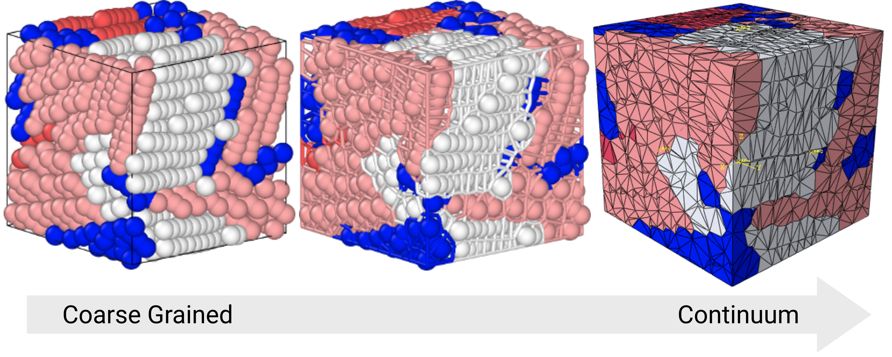

# MDvoro

A Python package for hierarchical multiscale modeling of polymers and composites using Voronoi tessellation and tetrahedral mesh generation.

## Overview



MDvoro enables the creation and analysis of complex material microstructures through:
- **Voronoi Tessellation**: Generate cellular structures from seed points using voro++
- **Tetrahedral Meshing**: Create high-quality finite element meshes using TetGen
- **Mesh Export**: Output to Abaqus (.inp) and OVITO formats for simulation and visualization
- **Grain Boundary Analysis**: Support for polycrystalline and composite material modeling

## Installation

### Requirements

- Python >= 3.9
- numpy
- scipy
- rich
- pyyaml
- TetGen ([external](https://github.com/TetGen/TetGen))
- voro++ ([external](https://github.com/chr1shr/voro))
- pothos ([external](https://github.com/Tj-Barrett/pothos), optional, but designed for use with this project)

### Install MDvoro

```bash
pip install -e .
```

Or install from source:

```bash
git clone https://github.com/tj-barrett/mdvoro
cd mdvoro
pip install -e .
```

## Configuration

Modify the `config.yaml` file in the mdvoro package directory for your system:

```yaml
tetgen: "./tetgen"      # Path or alias to tetgen executable
voro++: "voro++"        # Path or alias to voro++ executable
```

## Usage

### Basic Voronoi Tessellation

```python
from mdvoro.mesh.compute_voro import compute_voro
from pothos.align import align

# Use pothos to find crystals
pa = align('small_test.dump')
pa.ncpus=1
pa.series=False

pa.align_type = 'P2'
pa.length_coeff = 2

pa.legendre_cutoff = 0.90
pa.eps = 1.1
pa.lam = 0.95

pa.method = 'BallTree'

pa.leaf_size = 13
pa.min_pts = 2

pa.atom_types = 1
pa.just_atoms = True

pa.min_length = 2
pa.second_filt = True
pa.window = 'parzen'

pa.crystalmin = 25
pa.coloring = 'herman'

pa.find()

# Define seed points (x, y, z, [phase])
# Define simulation box limits
seeds, lims = pa.voro_dump()

# Compute Voronoi tessellation
voro = compute_voro(seeds, lims,
                    dispersion=1.0,
                    periodic=[False, False, False],
                    method='voro++')
```

### Generate Tetrahedral Mesh

```python
from mdvoro.mesh.tetgen import tetgen

# Initialize tetgen mesher
mesh = tetgen()

# Generate mesh from Voronoi tessellation
voro_out = mesh.mesh(voro, lims,
                     method='tetgen',
                     periodic=[False, False, False],
                     tetcmds='pkYAV')

# Write Abaqus input file
mesh.write('output.inp', method='abaqus')
```

### OVITO Visualization

```python
from mdvoro.utils.ovito_writer import ovito_writer

# Write OVITO-compatible dump file
ovito_writer('output.dump', voro, lims)
```

### Advanced Options

#### Shimmy (Perturb Seed Positions)

```python
# Random perturbation of all seeds
voro = compute_voro(seeds, lims, shimmy=0.1)

# Perturb a specific seed
voro = compute_voro(seeds, lims, shimmy_atom=[0, 0.1])  # [index, displacement]
```

#### Periodic Boundaries

```python
# Enable periodic boundaries in x and y
voro = compute_voro(seeds, lims, periodic=[True, True, False])
```

#### Mesh Decimation

```python
# Adjust decimation cutoff (default: average cell size / 3)
voro_out = mesh.mesh(voro, lims, decimate_cutoff=0.5)
```

#### TetGen Parameters

```python
# Common TetGen switches:
# p - Tetrahedralize a piecewise linear complex
# q - Quality mesh generation
# a - Maximum tetrahedron volume constraint
# A - Region-wise volume constraints

voro_out = mesh.mesh(voro, lims, tetcmds='pq1.2a5A')
```

## Output Formats

### Abaqus (.inp)
- Tetrahedral elements (C3D4)
- Element sets by phase/region
- Node sets for boundary conditions
- Reference points for periodic boundary conditions

### OVITO (.dump)
- Atoms represent Voronoi vertices
- Bonds represent cell edges
- Molecular representation for visualization
- Compatible with OVITO visualization software

## Citation

If you use MDvoro in your research, please cite:

```
Barrett, T.J., Muftu, S., and Minus, M.L. (2025)
MDvoro: A Python Package for Hierarchical Multiscale Modeling
Version 2025.09
```

## Authors

- **Thomas J. Barrett** - barrett.t@northeastern.edu
- **Advisor**: Marilyn L. Minus
- Northeastern University
